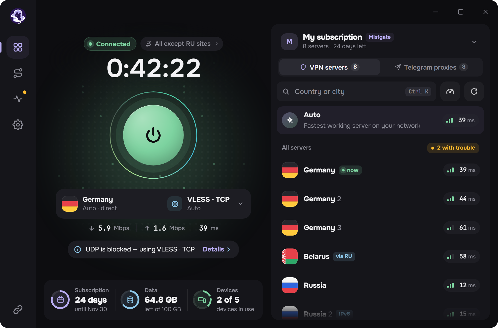
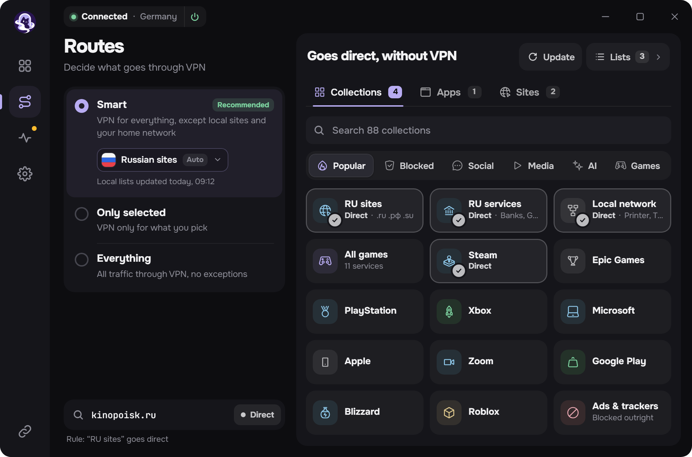
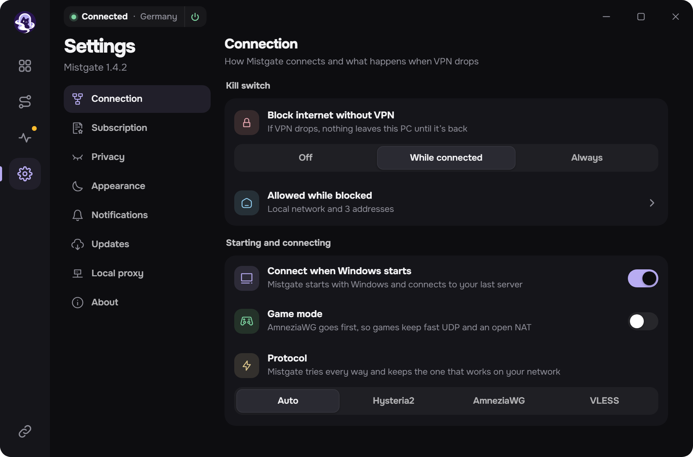
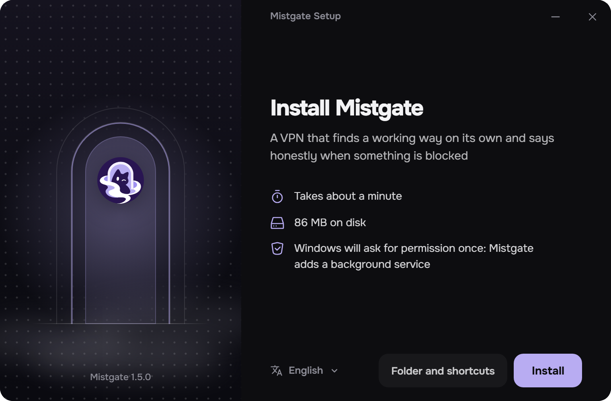

<h1>Mistgate برای ویندوز</h1>

یک برنامهٔ VPN که خودش راهِ سالم را پیدا می‌کند و وقتی چیزی مسدود است، روراست می‌گوید. 
Hysteria2، AmneziaWG و VLESS در یک پنجره. برای پنل‌های <a href="https://github.com/Mistgate/mistgate">Mistgate</a> و برای لینک‌های اشتراک معمولی.

<a href="https://github.com/Mistgate/mistgate-client/releases/latest"><b>دانلود</b></a> · <a href="docs/build.md"><b>ساخت</b></a> · <a href="README.md">English</a> · <a href="README.ru.md">Русский</a> · <a href="README.zh.md">简体中文</a> · <a href="README.tr.md">Türkçe</a>

<b>بتا.</b> نسخهٔ 0.1، فقط ویندوز. تا پیش از 1.0 ممکن است تغییر کند.

تصویرهای این صفحه، صفحه‌های خودِ برنامه با داده‌های نمونه‌اند.

## چه می‌کند

اشتراک را یک بار اضافه می‌کنید. برنامه فهرست سرورها را به‌روز نگه می‌دارد، با پروتکلی که در شبکهٔ شما کار می‌کند وصل می‌شود و فقط چیزی را که می‌خواهید از VPN رد می‌کند.

- **یک کلید، سه پروتکل.** Hysteria2، AmneziaWG و VLESS. حالت *خودکار* سروری را برمی‌دارد که همین حالا زودتر پاسخ می‌دهد؛ سرور و پروتکل را خودتان هم می‌توانید انتخاب کنید.
- **با پنل Mistgate و بدون آن.** لینک اشتراک، لینک‌های `hysteria2://` یا `vless://`، پروفایل Mihomo یا پیکربندی AmneziaWG را بچسبانید. با پنل Mistgate برنامه این رایانه را با کلید خودش ثبت می‌کند، سرورهای پنل را دنبال می‌کند و طرح، حجم مصرف‌شده و دستگاه‌ها را نشان می‌دهد.
- **مسیرها.** *هوشمند* سایت‌های داخلی و شبکهٔ خانه را بیرون از VPN نگه می‌دارد، *فقط انتخاب‌شده‌ها* تنها چیزی را که برگزیده‌اید از VPN می‌فرستد و *همه‌چیز* کل ترافیک را. قاعده بر پایهٔ مجموعه‌های آماده، فهرست‌های خودتان، سایت‌ها و برنامه‌ها.
- **Kill switch.** تا وقتی تونل قطع است چیزی از رایانه بیرون نمی‌رود: هنگام اتصال، یا همیشه.
- **بررسی شبکه.** یک دکمه نشان می‌دهد از اینجا کدام سرورها و کدام راه‌ها کار می‌کنند.
- **پروکسی محلی.** SOCKS5 و HTTP برای برنامه‌ها و دستگاه‌های خانه که خودشان نمی‌توانند از VPN استفاده کنند.
- **پروکسی‌های تلگرام** از پنل: با یک فشار، پروکسی به تلگرام داده می‌شود.
- **بقیه.** پنل سریع در سینی سیستم، اعلان‌های ویندوز، پوستهٔ تیره و روشن، پنج زبان: انگلیسی، روسی، چینی، فارسی، ترکی.
- **به‌روزرسانی** از انتشارهای همین مخزن. برنامه فقط نصب‌کننده‌ای را نصب می‌کند که با کلید پروژه امضا شده باشد.

<table>
  <tr>
    <td width="50%"></td>
    <td width="50%"></td>
  </tr>
  <tr>
    <td align="center">مسیرها: چه چیزی از VPN می‌رود و چه چیزی نه</td>
    <td align="center">تنظیمات</td>
  </tr>
</table>

## پروتکل‌ها

| پروتکل | در برنامه | چه چیزی را پشتیبانی می‌کند |
|:--|:--|:--|
| Hysteria2 | هستهٔ رسمی Hysteria2، درون برنامه | UDP (QUIC). مبهم‌سازی Salamander، پرش پورت. |
| AmneziaWG | amneziawg-go، درون برنامه | نسخه‌های 2.0 و 3.1، یک کلید برای هر دستگاه از پنل Mistgate یا فایل `.conf`. |
| VLESS | Xray-core، درون برنامه | REALITY یا TLS؛ RAW با Vision، XHTTP و WebSocket. |

هر سه درون یک سرویس ویندوز و یک آداپتور wintun کار می‌کنند. پشتیبانی نمی‌شوند: VMess، Trojan، Shadowsocks، TUIC و WireGuard ساده.

## نصب

ویندوز 10 یا 11، x64.

1. فایل `MistgateSetup_<version>_x64.exe` را از [آخرین انتشار](https://github.com/Mistgate/mistgate-client/releases/latest) بگیرید و اجرا کنید.
2. ویندوز یک بار اجازهٔ مدیر می‌خواهد: برنامه یک سرویس پس‌زمینه نصب می‌کند که تونل را نگه می‌دارد.
3. لینک اشتراک را بچسبانید و دکمهٔ بزرگ را بزنید.

نصب‌کننده هنوز گواهی امضای کد ویندوز ندارد، پس SmartScreen ممکن است دربارهٔ ناشر ناشناس هشدار بدهد. به‌روزرسانی‌ها به شکل دیگری، با امضای خودِ پروژه، بررسی می‌شوند: [به‌روزرسانی چگونه کار می‌کند](docs/build.md#updates-of-the-installed-app).

 

## حریم خصوصی

- کلیدهای دستگاه و اطلاعات سرورها در انباره‌ای می‌مانند که ویندوز آن را برای حساب خودِ سرویس رمز می‌کند.
- در گزارش رویدادها کلید، لینک، نشانی سرور، نام سایت یا نام برنامه نیست.
- برنامه به پنل نمی‌گوید چه چیزی را باز می‌کنید. بستهٔ اشکال‌زدایی فقط وقتی دکمهٔ ارسال را بزنید از رایانه بیرون می‌رود و برنامه پیش از ارسال آن را خط‌به‌خط نشان می‌دهد.

## وضعیت

این نسخه بتا است و پروژه جوان است. هنوز نیست: گواهی امضای کد ویندوز، صفحهٔ حذفِ اختصاصی، نسخه‌های macOS و Linux. اگر چیزی کار نمی‌کند، [یک issue باز کنید](https://github.com/Mistgate/mistgate-client/issues). ساختن از کد: [docs/build.md](docs/build.md).

## مجوز

[AGPL-3.0](LICENSE). کتابخانه‌هایی که به آن پیوند شده‌اند مجوز خودشان را دارند، از جمله Xray-core (MPL-2.0)، Hysteria، amneziawg-go، gVisor و wintun.

