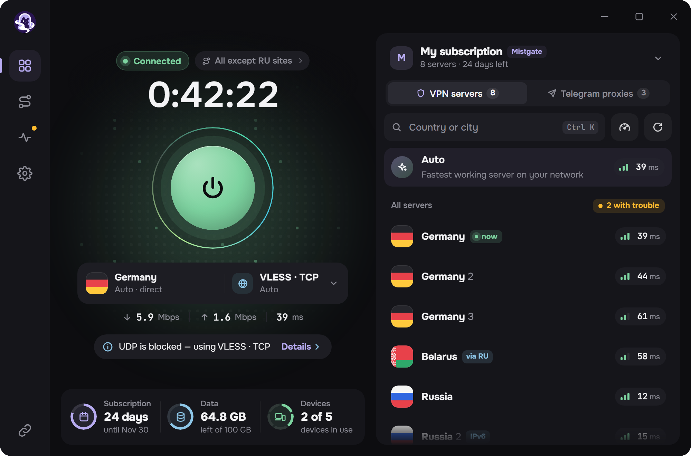
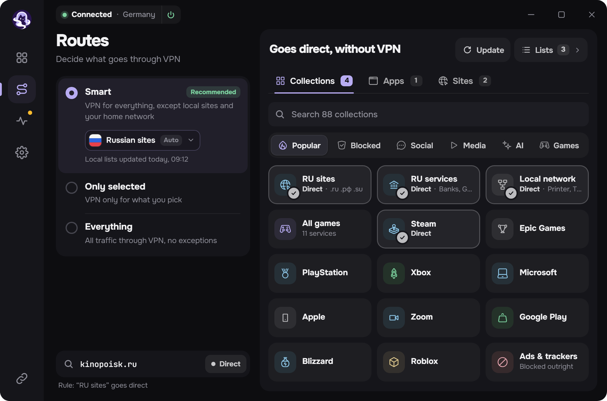
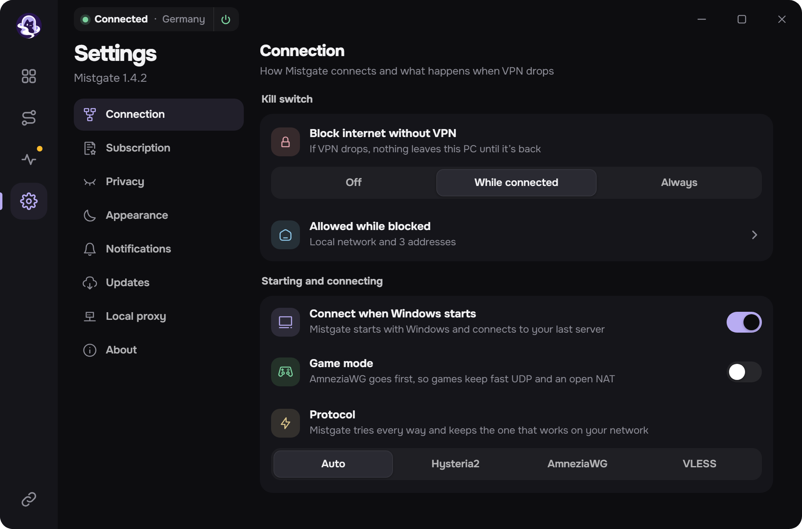
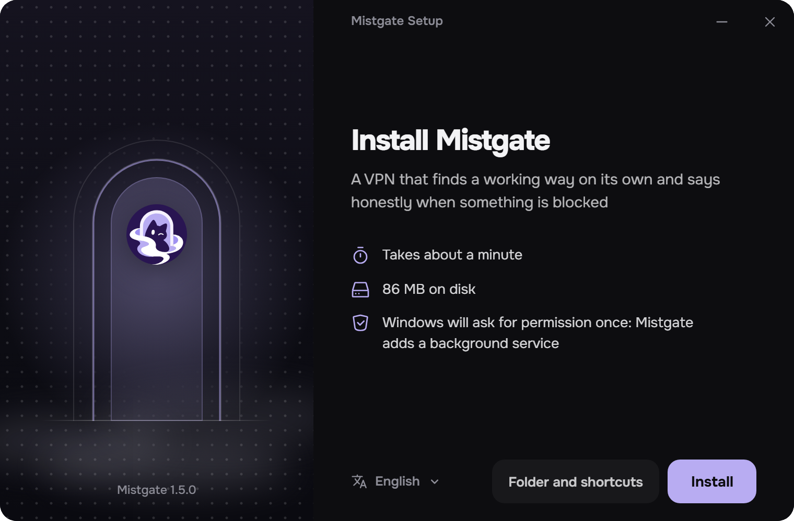

<h1 align="center">Mistgate</h1>

<p align="center">
  A desktop VPN client for Windows: Hysteria2, AmneziaWG and VLESS in one app,<br>
  with routes by site, by list and by program, and a network check that says what is blocked.
</p>

<p align="center">
  <a href="https://github.com/Mistgate/mistgate-client/releases/latest"><b>Download</b></a> ·
  <a href="docs/build.md">Build it yourself</a> ·
  <a href="docs/ipc.md">How the parts talk</a> ·
  <a href="LICENSE">AGPL-3.0</a>
</p>

<p align="center"></p>

> The pictures on this page are the app's screens filled with sample data.

## What it does

- **Three protocols, one switch.** Hysteria2, AmneziaWG (2.0 and 3.1) and VLESS (REALITY or TLS; raw, XHTTP and WebSocket
  transports). "Auto" takes the server that answers quickest on the network you are on.
- **Works with a Mistgate panel, and without one.** Paste a subscription link, `hysteria2://` or `vless://` links, a
  Mihomo profile or an AmneziaWG config. With a Mistgate panel the app enrols the device with its own key, follows the
  panel's server list, and shows the plan, the data used and the devices.
- **Routes.** *Smart* keeps local sites and the home network outside the VPN, *Only selected* sends through it just
  what you pick, *Everything* sends all of it. Rules by ready-made collections, by your own lists, by site and by
  program.
- **Kill switch** that holds the traffic while the tunnel is down, in two strengths.
- **Local proxy** (SOCKS5 and HTTP) for the programs and the home devices that cannot use the VPN directly.
- **Network check.** One button tells which servers and which ways to them work from here, and what the network does
  to the rest.
- **Telegram proxies** from the panel, one press to hand them to Telegram.
- **Quick panel in the tray**, Windows notifications, five languages (English, Russian, Chinese, Persian, Turkish),
  dark and light themes.
- **Updates** from this repository's releases; the app installs only an installer signed with the project's key.

<table>
  <tr>
    <td width="50%"></td>
    <td width="50%"></td>
  </tr>
  <tr>
    <td align="center"><sub>Routes: three modes, collections, programs, sites</sub></td>
    <td align="center"><sub>Settings</sub></td>
  </tr>
</table>

<p align="center"></p>

## Install

Windows 10 or 11, x64. Take `MistgateSetup_<version>_x64.exe` from the
[latest release](https://github.com/Mistgate/mistgate-client/releases/latest) and run it. It asks for administrator
rights once: the app installs a Windows service that owns the tunnel.

The installer is not signed with a Windows code-signing certificate yet, so SmartScreen may warn about an unknown
publisher. Updates are checked in another way, by the project's own signature: see
[Updates of the installed app](docs/build.md#updates-of-the-installed-app).

## How it is built

| Part | What it is |
|---|---|
| `core/` | The service, in Go (`mistgate-clientd`, runs as LocalSystem): the tunnel, the routes, the kill switch, the subscriptions, the network check. Hysteria2, AmneziaWG and Xray are linked in as libraries; packets go through a wintun adapter. |
| `ui/` | The window, the tray panel and the setup program: Tauri 2 with a small React shell. It talks to the service over one named pipe that accepts only the installed app. |
| `design/` | The screens as designed. `ui/src/screens` and `ui/src/design` are generated from them (`pnpm design`), the `ui/src/live*.ts` layers put the real state in. |
| `docs/` | [Building](docs/build.md), [the pipe's protocol](docs/ipc.md), [the panel's client API](docs/client-api.md). |

```
cd ui
pnpm install
pnpm bundle
```

Details, and the Go version that must not be used, are in [docs/build.md](docs/build.md).

## Privacy

The service keeps device keys and server credentials in a store encrypted by Windows for the service's own account.
The log holds no keys, links, addresses of servers, names of sites or of programs. Nothing is sent to the panel about
what you open; a debug bundle goes out only when you press send, and the app shows it line by line first.

## Status

Early: version 0.1. Windows only. Things known to be missing are a signed installer, an uninstall screen of its own,
and macOS and Linux builds.

## Licence

[AGPL-3.0](LICENSE). The libraries it links keep their own licences, among them Xray-core (MPL-2.0), Hysteria,
amneziawg-go, gVisor and wintun.

---

<details>
<summary>По-русски</summary>

Mistgate — клиент VPN для Windows: Hysteria2, AmneziaWG и VLESS в одном приложении. Работает с панелью Mistgate и с
обычной ссылкой подписки. Три режима маршрутов (умный, только выбранное, всё), правила по сайтам, спискам и
программам, kill switch, локальный прокси, проверка сети, прокси для Telegram, панель в трее, пять языков.
Обновляется из релизов этого репозитория и ставит только установщик, подписанный ключом проекта.

Установка: скачайте `MistgateSetup_<версия>_x64.exe` из
[последнего релиза](https://github.com/Mistgate/mistgate-client/releases/latest) и запустите.

</details>
