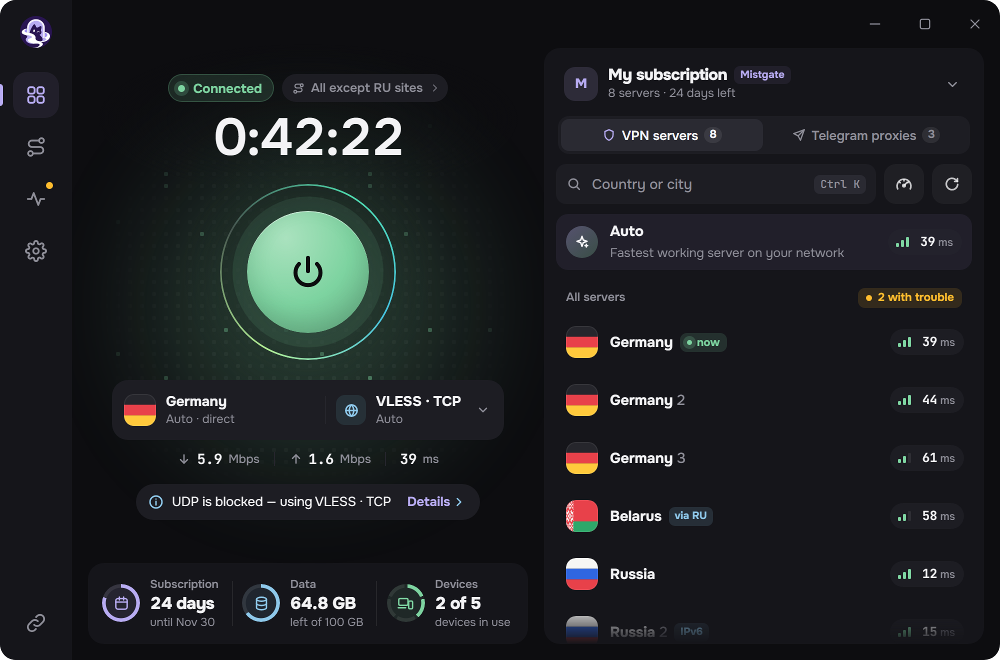
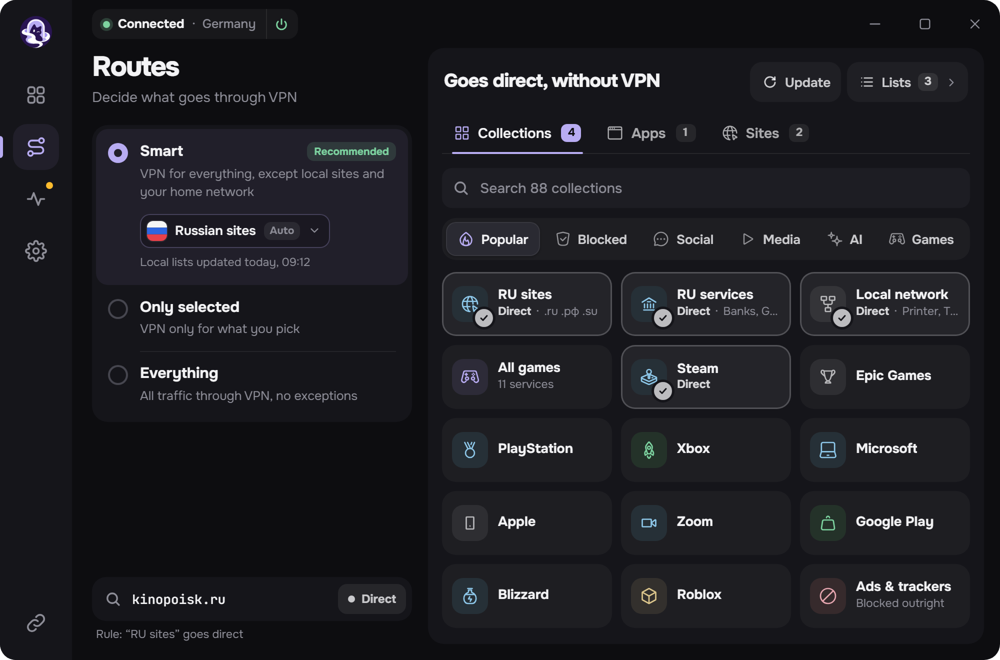
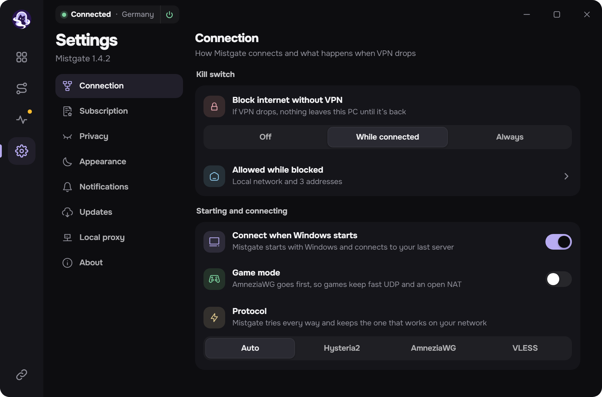
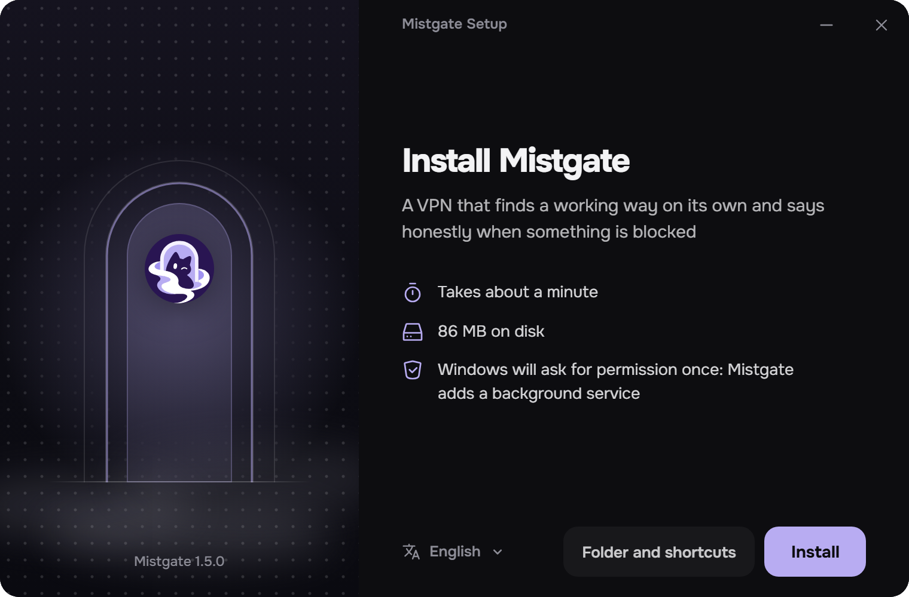

<h1>Mistgate для Windows</h1>

VPN-приложение, которое само находит рабочий путь и честно говорит, когда что-то заблокировано. 
Hysteria2, AmneziaWG и VLESS в одном окне. Для панелей <a href="https://github.com/Mistgate/mistgate">Mistgate</a> и для обычных ссылок подписки.

<a href="https://github.com/Mistgate/mistgate-client/releases/latest"><b>Скачать</b></a> · <a href="docs/build.md"><b>Сборка</b></a> · <a href="README.md">English</a> · <a href="README.zh.md">简体中文</a> · <a href="README.fa.md">فارسی</a> · <a href="README.tr.md">Türkçe</a>

<b>Бета.</b> Версия 0.1, только Windows. До 1.0 возможны изменения.

Картинки на этой странице — экраны приложения с образцовыми данными.

## Что умеет

Подписка добавляется один раз. Приложение само обновляет список серверов, подключается тем протоколом, который работает в вашей сети, и пускает через VPN только то, что вы хотите.

- **Одна кнопка, три протокола.** Hysteria2, AmneziaWG и VLESS. *Авто* берёт сервер, который отвечает быстрее всех прямо сейчас; сервер и протокол можно выбрать и самому.
- **С панелью Mistgate и без неё.** Вставьте ссылку подписки, ссылки `hysteria2://` или `vless://`, профиль Mihomo или конфиг AmneziaWG. С панелью Mistgate приложение регистрирует этот ПК своим ключом, следит за серверами панели и показывает тариф, трафик и устройства.
- **Маршруты.** *Умный* оставляет местные сайты и домашнюю сеть мимо VPN, *Только выбранное* пускает через VPN лишь то, что вы отметили, *Всё* — весь трафик. Правила по готовым подборкам, своим спискам, сайтам и программам.
- **Kill switch.** Пока туннель лежит, с ПК ничего не уходит: на время подключения или всегда.
- **Проверка сети.** Одна кнопка показывает, какие серверы и какие пути к ним работают отсюда.
- **Локальный прокси.** SOCKS5 и HTTP для программ и домашних устройств, которые не умеют в VPN сами.
- **Прокси для Telegram** из панели: одно нажатие передаёт прокси в Telegram.
- **Остальное.** Быстрая панель в трее, уведомления Windows, тёмная и светлая темы, пять языков: английский, русский, китайский, фарси, турецкий.
- **Обновления** из релизов этого репозитория. Приложение ставит только установщик, подписанный ключом проекта.

<table>
  <tr>
    <td width="50%"></td>
    <td width="50%"></td>
  </tr>
  <tr>
    <td align="center">Маршруты: что идёт через VPN, а что нет</td>
    <td align="center">Настройки</td>
  </tr>
</table>

## Протоколы

| Протокол | В приложении | Что поддерживает |
|:--|:--|:--|
| Hysteria2 | Официальное ядро Hysteria2, встроено | UDP (QUIC). Обфускация Salamander, смена портов. |
| AmneziaWG | amneziawg-go, встроен | Версии 2.0 и 3.1, ключ на устройство из панели Mistgate или файл `.conf`. |
| VLESS | Xray-core, встроен | REALITY или TLS; RAW с Vision, XHTTP и WebSocket. |

Все три работают внутри одной службы Windows и одного адаптера wintun. Не поддерживаются: VMess, Trojan, Shadowsocks, TUIC и обычный WireGuard.

## Установка

Windows 10 или 11, x64.

1. Скачайте `MistgateSetup_<версия>_x64.exe` из [последнего релиза](https://github.com/Mistgate/mistgate-client/releases/latest) и запустите.
2. Windows один раз спросит права администратора: приложение ставит фоновую службу, которая держит туннель.
3. Вставьте ссылку подписки и нажмите большую кнопку.

У установщика пока нет сертификата подписи кода Windows, поэтому SmartScreen может предупредить о неизвестном издателе. Обновления проверяются иначе, собственной подписью проекта: [как устроены обновления](docs/build.md#updates-of-the-installed-app).

 

## Приватность

- Ключи устройства и данные серверов лежат в хранилище, которое Windows шифрует для учётной записи службы.
- В журнале нет ключей, ссылок, адресов серверов, имён сайтов и программ.
- Приложение не сообщает панели, что вы открываете. Отладочный отчёт уходит с ПК только по вашей кнопке, и перед отправкой приложение показывает его построчно.

## Состояние

Это бета, проект молодой. Пока нет: сертификата подписи кода Windows, своего экрана удаления, сборок для macOS и Linux. Если что-то не работает, [создайте issue](https://github.com/Mistgate/mistgate-client/issues). Как собрать самому: [docs/build.md](docs/build.md).

## Лицензия

[AGPL-3.0](LICENSE). У встроенных библиотек свои лицензии, среди них Xray-core (MPL-2.0), Hysteria, amneziawg-go, gVisor и wintun.

