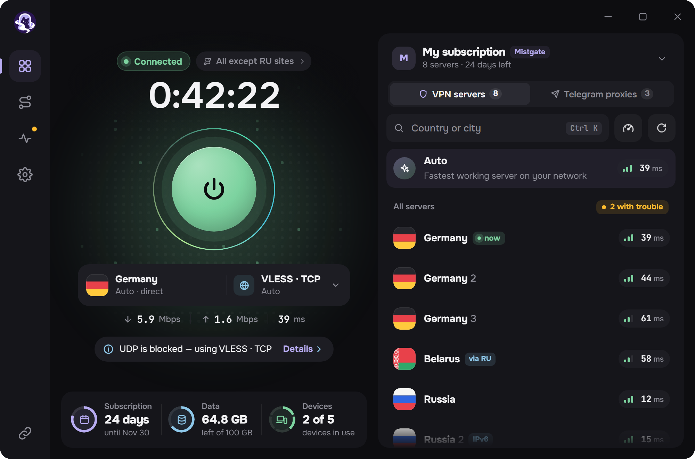
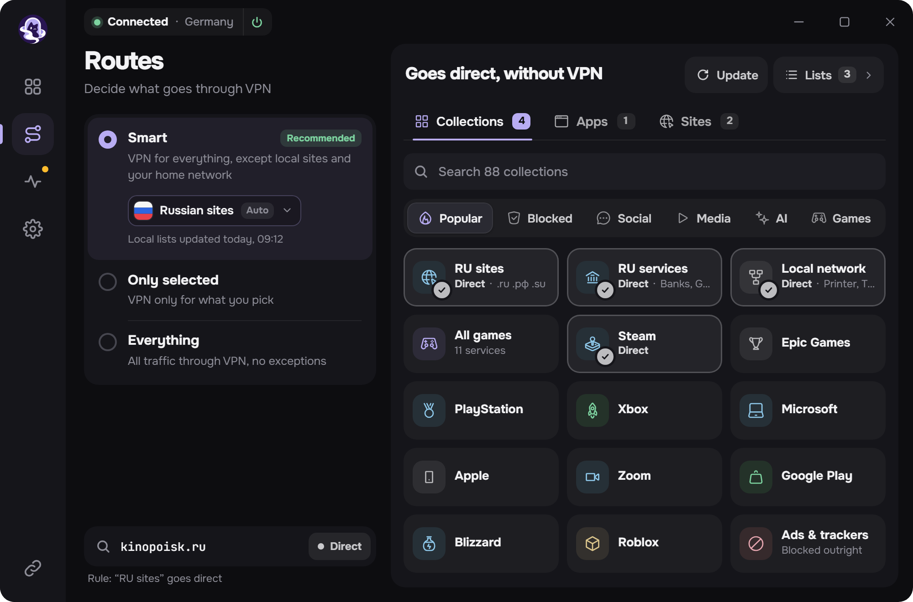
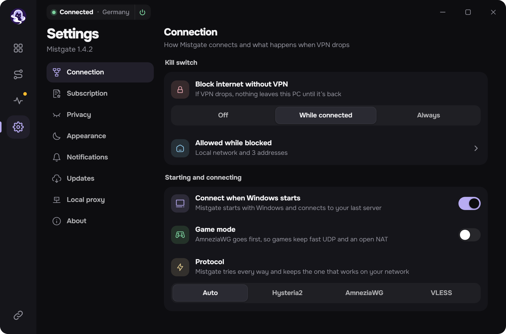
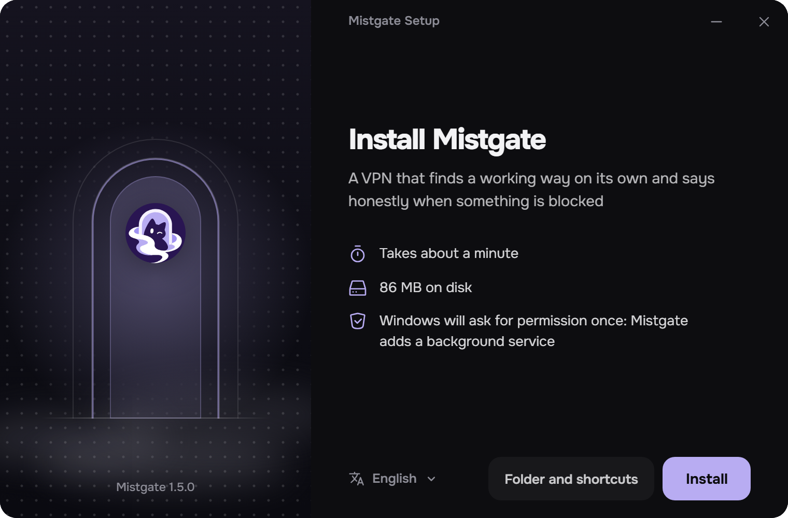

<h1>Windows için Mistgate</h1>

Çalışan yolu kendi bulan ve bir şey engellendiğinde bunu dürüstçe söyleyen bir VPN uygulaması. 
Hysteria2, AmneziaWG ve VLESS tek pencerede. <a href="https://github.com/Mistgate/mistgate">Mistgate</a> panelleri ve sıradan abonelik bağlantıları için.

<a href="https://github.com/Mistgate/mistgate-client/releases/latest"><b>İndir</b></a> · <a href="docs/build.md"><b>Derleme</b></a> · <a href="README.md">English</a> · <a href="README.ru.md">Русский</a> · <a href="README.zh.md">简体中文</a> · <a href="README.fa.md">فارسی</a>

<b>Beta.</b> Sürüm 0.1, yalnızca Windows. 1.0 öncesinde değişiklikler olabilir.

Bu sayfadaki görseller, uygulamanın örnek verilerle doldurulmuş kendi ekranlarıdır.

## Neler yapar

Aboneliği bir kez eklersiniz. Uygulama sunucu listesini güncel tutar, bulunduğunuz ağda çalışan protokolle bağlanır ve VPN üzerinden yalnızca istediğinizi geçirir.

- **Tek düğme, üç protokol.** Hysteria2, AmneziaWG ve VLESS. *Otomatik*, o anda en hızlı yanıt veren sunucuyu seçer; sunucuyu ve protokolü kendiniz de seçebilirsiniz.
- **Mistgate paneliyle de, panelsiz de.** Abonelik bağlantısını, `hysteria2://` veya `vless://` bağlantılarını, bir Mihomo profilini ya da AmneziaWG yapılandırmasını yapıştırın. Mistgate panelinde uygulama bu bilgisayarı kendi anahtarıyla kaydeder, panelin sunucularını izler ve planı, kullanılan veriyi ve cihazları gösterir.
- **Rotalar.** *Akıllı*, yerel siteleri ve ev ağını VPN dışında bırakır; *Yalnızca seçilenler* sadece seçtiklerinizi VPN'den geçirir; *Her şey* tüm trafiği geçirir. Hazır koleksiyonlara, kendi listelerinize, sitelere ve programlara göre kurallar.
- **Kill switch.** Tünel kapalıyken bilgisayardan hiçbir şey çıkmaz: bağlıyken veya her zaman.
- **Ağ denetimi.** Tek düğme, buradan hangi sunucuların ve hangi yolların çalıştığını gösterir.
- **Yerel vekil.** VPN'i doğrudan kullanamayan programlar ve evdeki cihazlar için SOCKS5 ve HTTP.
- **Telegram vekilleri** panelden gelir: tek dokunuşla Telegram'a aktarılır.
- **Diğerleri.** Sistem tepsisinde hızlı panel, Windows bildirimleri, koyu ve açık tema, beş dil: İngilizce, Rusça, Çince, Farsça, Türkçe.
- **Güncellemeler** bu deponun sürümlerinden gelir. Uygulama yalnızca projenin anahtarıyla imzalanmış kurulum dosyasını kurar.

<table>
  <tr>
    <td width="50%"></td>
    <td width="50%"></td>
  </tr>
  <tr>
    <td align="center">Rotalar: neyin VPN üzerinden gittiği, neyin gitmediği</td>
    <td align="center">Ayarlar</td>
  </tr>
</table>

## Protokoller

| Protokol | Uygulamada | Neleri destekler |
|:--|:--|:--|
| Hysteria2 | Resmî Hysteria2 çekirdeği, gömülü | UDP (QUIC). Salamander gizleme, port atlama. |
| AmneziaWG | amneziawg-go, gömülü | 2.0 ve 3.1 sürümleri; cihaz başına bir anahtar, Mistgate panelinden veya `.conf` dosyasından. |
| VLESS | Xray-core, gömülü | REALITY veya TLS; Vision ile RAW, XHTTP ve WebSocket. |

Üçü de tek bir Windows hizmeti ve tek bir wintun bağdaştırıcısı içinde çalışır. Desteklenmeyenler: VMess, Trojan, Shadowsocks, TUIC ve düz WireGuard.

## Kurulum

Windows 10 veya 11, x64.

1. [Son sürümden](https://github.com/Mistgate/mistgate-client/releases/latest) `MistgateSetup_<sürüm>_x64.exe` dosyasını indirip çalıştırın.
2. Windows bir kez yönetici izni ister: uygulama, tüneli yöneten bir arka plan hizmeti kurar.
3. Abonelik bağlantınızı yapıştırın ve büyük düğmeye basın.

Kurulum dosyasının henüz Windows kod imzalama sertifikası yok, bu yüzden SmartScreen bilinmeyen yayıncı uyarısı verebilir. Güncellemeler başka bir yolla, projenin kendi imzasıyla denetlenir: [güncellemeler nasıl çalışır](docs/build.md#updates-of-the-installed-app).

 

## Gizlilik

- Cihaz anahtarları ve sunucu bilgileri, Windows'un hizmetin kendi hesabı için şifrelediği bir depoda durur.
- Günlükte anahtar, bağlantı, sunucu adresi, site adı veya program adı bulunmaz.
- Uygulama ne açtığınızı panele bildirmez. Hata ayıklama paketi yalnızca siz gönder düğmesine bastığınızda bilgisayardan çıkar ve uygulama önce onu satır satır gösterir.

## Durum

Bu bir beta ve proje genç. Henüz yok: Windows kod imzalama sertifikası, kendine ait kaldırma ekranı, macOS ve Linux sürümleri. Bir şey çalışmıyorsa [bir issue açın](https://github.com/Mistgate/mistgate-client/issues). Kendiniz derlemek için: [docs/build.md](docs/build.md).

## Lisans

[AGPL-3.0](LICENSE). Bağlanan kitaplıkların kendi lisansları vardır; aralarında Xray-core (MPL-2.0), Hysteria, amneziawg-go, gVisor ve wintun bulunur.

