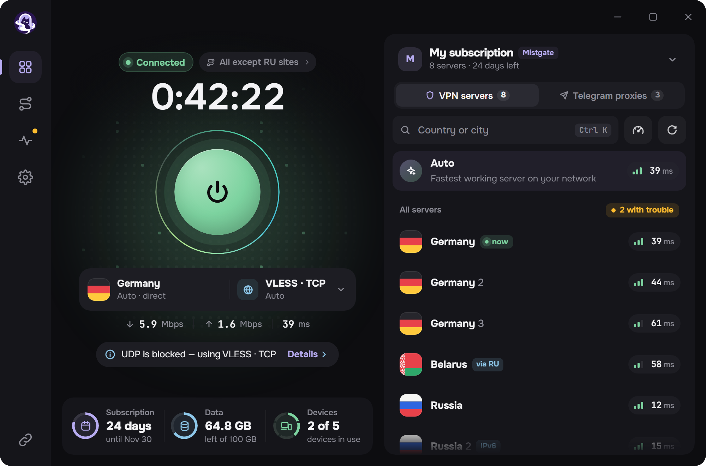
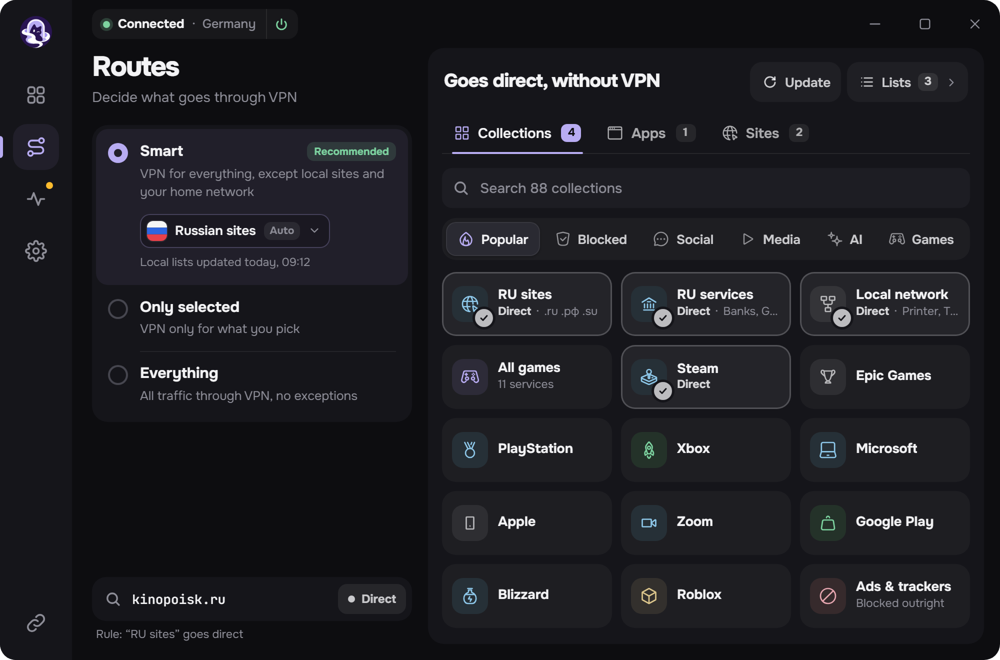
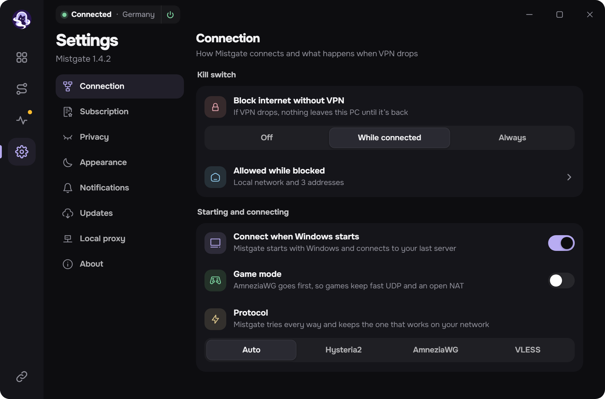
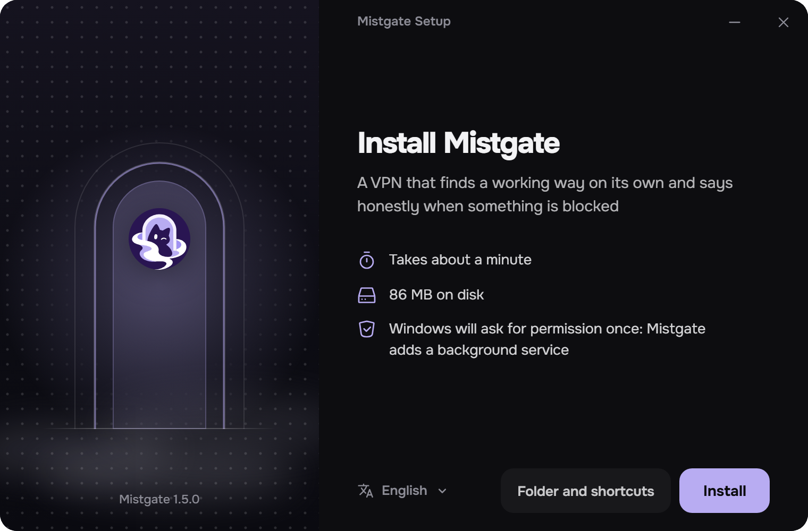

<h1>Mistgate Windows 客户端</h1>

一款会自己找到可用线路、并在被封锁时如实告诉你的 VPN 应用。 
Hysteria2、AmneziaWG 和 VLESS 集于一个窗口。适用于 <a href="https://github.com/Mistgate/mistgate">Mistgate</a> 面板，也适用于普通订阅链接。

<a href="https://github.com/Mistgate/mistgate-client/releases/latest"><b>下载</b></a> · <a href="docs/build.md"><b>构建</b></a> · <a href="README.md">English</a> · <a href="README.ru.md">Русский</a> · <a href="README.fa.md">فارسی</a> · <a href="README.tr.md">Türkçe</a>

<b>测试版。</b>版本 0.1，仅支持 Windows。1.0 之前可能有变动。

本页图片是填入示例数据的应用界面。

## 功能

订阅只需添加一次。应用会自动更新服务器列表，用当前网络下可用的协议连接，并且只让你指定的流量走 VPN。

- **一个开关，三种协议。** Hysteria2、AmneziaWG 和 VLESS。*自动* 会选择此刻响应最快的服务器；也可以自己选择服务器和协议。
- **有无 Mistgate 面板都能用。** 粘贴订阅链接、`hysteria2://` 或 `vless://` 链接、Mihomo 配置或 AmneziaWG 配置即可。使用 Mistgate 面板时，应用用自己的密钥登记这台电脑，跟随面板的服务器，并显示套餐、已用流量和设备。
- **路由。** *智能* 让本地网站和家庭网络不走 VPN，*仅所选* 只让你选中的内容走 VPN，*全部* 让所有流量都走。可按现成合集、自己的列表、网站和程序设置规则。
- **Kill switch。** 隧道断开时，电脑不会有任何流量外泄：仅在连接期间，或始终生效。
- **网络检测。** 一个按钮即可看出从这里哪些服务器、哪些线路可用。
- **本地代理。** SOCKS5 和 HTTP，供无法直接使用 VPN 的程序和家中设备使用。
- **Telegram 代理**来自面板：点一下即可交给 Telegram。
- **其他。** 托盘快捷面板、Windows 通知、深色和浅色主题，五种语言：英语、俄语、中文、波斯语、土耳其语。
- **更新**来自本仓库的发布页。应用只安装用项目密钥签名的安装程序。

<table>
  <tr>
    <td width="50%"></td>
    <td width="50%"></td>
  </tr>
  <tr>
    <td align="center">路由：哪些走 VPN，哪些不走</td>
    <td align="center">设置</td>
  </tr>
</table>

## 协议

| 协议 | 在应用中 | 支持内容 |
|:--|:--|:--|
| Hysteria2 | 官方 Hysteria2 内核，内置 | UDP (QUIC)。Salamander 混淆，端口跳跃。 |
| AmneziaWG | amneziawg-go，内置 | 2.0 和 3.1 版，每台设备一把密钥，来自 Mistgate 面板或 `.conf` 文件。 |
| VLESS | Xray-core，内置 | REALITY 或 TLS；RAW + Vision、XHTTP 和 WebSocket。 |

三种协议都运行在同一个 Windows 服务和同一个 wintun 网卡中。不支持：VMess、Trojan、Shadowsocks、TUIC 和原版 WireGuard。

## 安装

Windows 10 或 11，x64。

1. 从[最新发布](https://github.com/Mistgate/mistgate-client/releases/latest)下载 `MistgateSetup_<版本>_x64.exe` 并运行。
2. Windows 会请求一次管理员权限：应用会安装一个负责隧道的后台服务。
3. 粘贴订阅链接，按下大按钮。

安装程序暂时没有 Windows 代码签名证书，SmartScreen 可能提示未知发布者。更新则用项目自己的签名校验：[更新的工作方式](docs/build.md#updates-of-the-installed-app)。

 

## 隐私

- 设备密钥和服务器凭据保存在由 Windows 为该服务账户加密的存储中。
- 日志中没有密钥、链接、服务器地址、网站名或程序名。
- 应用不会把你访问的内容告诉面板。调试报告只有在你点击发送时才会离开电脑，发送前应用会逐行显示其内容。

## 状态

这是测试版，项目还很新。目前还没有：Windows 代码签名证书、专门的卸载界面、macOS 和 Linux 版本。如果有问题，请[提交 issue](https://github.com/Mistgate/mistgate-client/issues)。自行构建见 [docs/build.md](docs/build.md)。

## 许可证

[AGPL-3.0](LICENSE)。所链接的库各有自己的许可证，其中包括 Xray-core (MPL-2.0)、Hysteria、amneziawg-go、gVisor 和 wintun。

